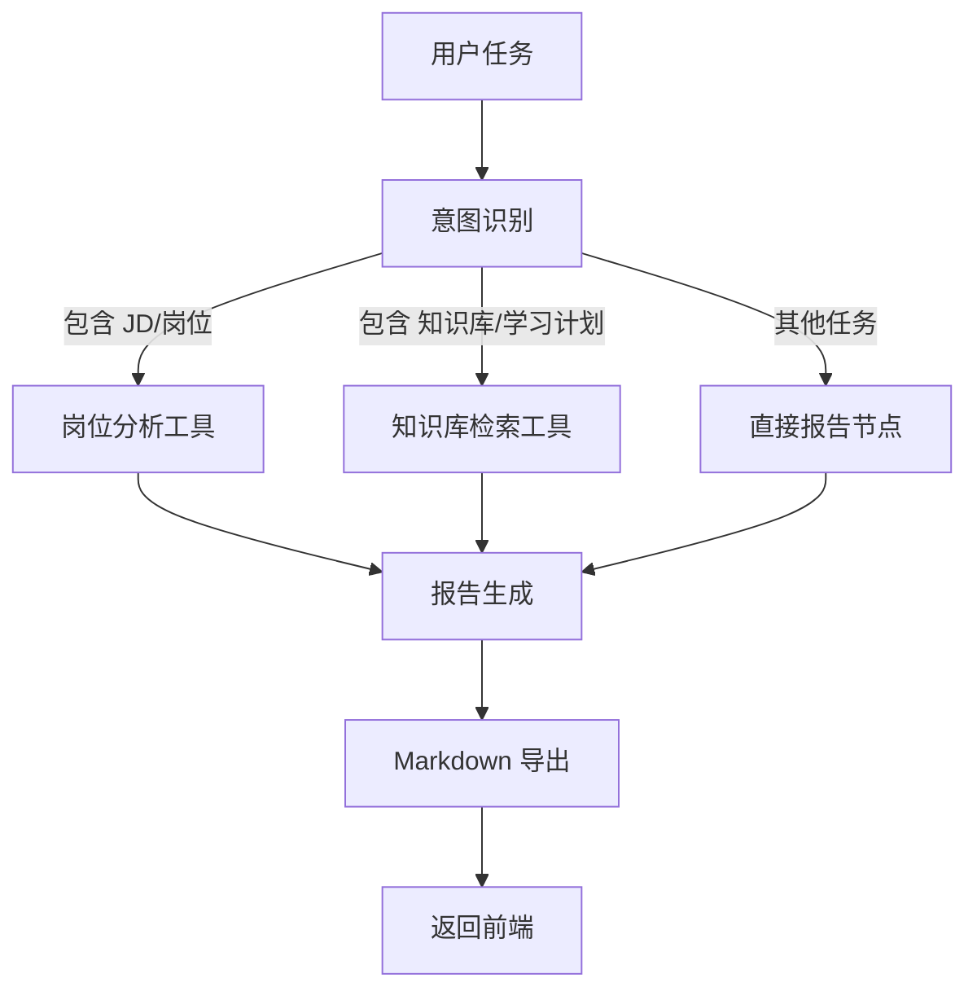

# AI JD Analyzer · 企业知识库智能体助手

一个面向 AI 求职和知识学习场景的本地 Web 应用。项目以 FastAPI 为后端、原生 HTML/CSS/JavaScript 为前端，结合大模型 API、Chroma 向量库、SQLite 和 LangGraph，提供岗位 JD 分析、文档知识库问答以及复杂任务 Agent。

## 目录

- [功能概览](#功能概览)
- [技术栈](#技术栈)
- [项目结构](#项目结构)
- [运行环境](#运行环境)
- [安装与配置](#安装与配置)
- [启动项目](#启动项目)
- [网页使用流程](#网页使用流程)
- [API 接口](#api-接口)
- [Agent 工作流](#agent-工作流)
- [数据与生成目录](#数据与生成目录)
- [开发与测试](#开发与测试)
- [常见问题](#常见问题)
- [安全说明](#安全说明)

## 功能概览

### 1. AI 岗位 JD 分析

输入一段岗位描述，调用配置的大模型返回结构化分析结果，通常包括岗位核心技能、加分技能、学习建议、简历关键词和岗位总结。

### 2. RAG 知识库

- 支持上传 `TXT`、`MD`、`PDF`、`DOCX` 文件
- 自动提取文本并按 500 字符切分，切分重叠 100 字符
- 使用 Chroma 持久化保存文本片段
- 按相似度检索 Top K 片段
- 基于检索结果生成回答，并返回来源文件、片段序号和距离
- 使用 SQLite 保存已上传文档和问答历史

### 3. LangGraph Agent

Agent 会先判断任务意图，再选择岗位分析工具或知识库检索工具，最后生成学习计划/报告并导出为 Markdown 文本。适合处理例如：

```text
根据这个岗位 JD 和知识库内容，生成一份学习计划
根据知识库内容总结 RAG 学习重点
分析下面这个 AI 岗位需要掌握哪些技术
```

## 技术栈

- Python 3.10+
- FastAPI / Uvicorn
- Pydantic
- OpenAI 兼容客户端（默认连接 DeepSeek API）
- ChromaDB
- LangGraph / LangChain Text Splitters
- SQLite
- pypdf / python-docx（文档解析）
- 原生 HTML、CSS、JavaScript

## 项目结构

```text
ai_jd_analyzer/
├─ app/
│  ├─ main.py                  # FastAPI 应用入口和路由注册
│  ├─ schemas.py               # 请求模型和统一响应模型
│  ├─ api/
│  │  ├─ rag_api.py            # /rag 接口：上传、问答、文档、历史
│  │  └─ agent_api.py          # /agent/run 接口
│  ├─ services/
│  │  ├─ llm_service.py        # 大模型客户端调用
│  │  ├─ prompt_service.py     # JD 分析 Prompt
│  │  ├─ db_service.py         # SQLite 初始化和数据读写
│  │  ├─ file_service.py       # 上传文件保存与类型校验
│  │  └─ log_service.py        # 日志配置
│  ├─ rag/
│  │  ├─ document_loader.py    # TXT/MD/PDF/DOCX 文本提取
│  │  ├─ splitter.py           # 文本切分
│  │  ├─ vector_store.py       # Chroma 持久化与检索
│  │  └─ rag_service.py        # RAG 入库和问答服务
│  └─ agent/
│     ├─ state.py              # Agent 状态定义
│     ├─ tools.py              # Agent 工具
│     └─ graph.py              # LangGraph 节点和条件分支
├─ frontend/
│  ├─ index.html               # 单页 Web 界面
│  ├─ script.js                # 上传、问答、Agent 请求逻辑
│  └─ style.css                # 页面样式
├─ scripts/demo_requests.py    # 健康检查和 Agent 请求示例
├─ test_db.py                  # 数据库基础检查
├─ requirements.txt            # Python 依赖
├─ .env.example                # 环境变量模板
├─ data/                       # 自动生成 SQLite 数据库
├─ uploads/                    # 上传文件保存目录
├─ chroma_db/                  # Chroma 向量库目录
└─ logs/                       # 日志目录
```

## 运行环境

- Windows、macOS 或 Linux
- Python 3.10 或更高版本
- 可用的大模型 API Key
- PyCharm（推荐）或命令行

项目已经包含 `.venv` 时，优先使用项目自己的虚拟环境；不要把 `.venv` 目录提交到 Git。

## 安装与配置

### 1. 在 PyCharm 中打开项目

用 PyCharm 打开项目根目录 `ai_jd_analyzer`，然后在 **Settings → Project → Python Interpreter** 中选择项目解释器。推荐新建一个名为 `.venv` 的虚拟环境。

### 2. 安装依赖

在 PyCharm Terminal 中执行：

```powershell
python -m pip install --upgrade pip
python -m pip install -r requirements.txt
```

如果系统使用 `py` 命令，则执行：

```powershell
py -m pip install -r requirements.txt
```

### 3. 创建 `.env`

复制 `.env.example` 为项目根目录下的 `.env`，然后填写真实 API 配置：

```dotenv
DEEPSEEK_API_KEY=你的_API_KEY
DEEPSEEK_BASE_URL=https://api.deepseek.com
DEEPSEEK_MODEL=你的可用模型名称
```

`DEEPSEEK_MODEL` 必须是当前账号可以调用的模型名称。如果使用其他 OpenAI 兼容服务，可修改 `DEEPSEEK_BASE_URL`，并确认该服务支持 Chat Completions 接口。`.env` 已被 Git 忽略，不要把真实 API Key 写进代码、截图或提交记录。

## 启动项目

### PyCharm 运行

1. 打开 `app/main.py`。
2. 右键文件，选择 **Run 'main'**，或新建 Python 运行配置。
3. 如果使用 Uvicorn，运行配置可填写：
   - Module name：`uvicorn`
   - Parameters：`app.main:app --reload --host 127.0.0.1 --port 8001`
   - Working directory：项目根目录
4. 看到 Uvicorn 启动日志后，在浏览器打开 `http://127.0.0.1:8001/`。

### 命令行运行

必须在项目根目录执行：

```powershell
python -m uvicorn app.main:app --reload --host 127.0.0.1 --port 8001
```

启动后可访问：

- Web 页面：<http://127.0.0.1:8001/>
- Swagger 文档：<http://127.0.0.1:8001/docs>
- ReDoc：<http://127.0.0.1:8001/redoc>
- 健康检查：<http://127.0.0.1:8001/health>

停止服务：在终端按 `Ctrl + C`。

## 网页使用流程

### 文档上传

1. 在“上传文档”区域选择或拖入 `.txt`、`.md`、`.pdf`、`.docx` 文件。
2. 点击“开始上传”。
3. 后端会保存原文件、提取文本、切分片段并写入 Chroma。
4. 上传成功后，右侧“文档列表”会显示文件名和片段数量。

### 知识库问答

1. 在“知识库问答”输入问题。
2. 选择 `Top K`（检索片段数量，1～10）。
3. 点击“发送问题”。
4. 页面会展示回答和来源引用；问答会保存到“问答记录”。

### Agent 任务

1. 在“复杂任务”输入完整任务描述。
2. 点击“运行 Agent”。
3. Agent 根据关键词识别意图，调用岗位分析或知识库工具。
4. 页面优先展示 Markdown 报告，也可以点击“复制”保存结果。

## API 接口

所有接口返回统一格式：

```json
{
  "code": 200,
  "message": "success",
  "data": {}
}
```

### 健康检查

```http
GET /health
```

### JD 分析

```http
POST /analyze-jd
Content-Type: application/json
```

请求：

```json
{
  "jd": "AI智能体开发工程师，要求熟悉 Python、FastAPI、RAG 和 LangGraph。"
}
```

### RAG 接口

| 方法 | 路径 | 用途 |
|---|---|---|
| `POST` | `/rag/ingest` | 直接提交文本并写入知识库 |
| `POST` | `/rag/ask` | 检索知识库并生成回答 |
| `POST` | `/rag/documents/upload` | 上传 TXT/MD/PDF/DOCX 并入库 |
| `GET` | `/rag/documents` | 查询已上传文档 |
| `GET` | `/rag/history` | 查询问答历史 |

`/rag/ask` 请求示例：

```json
{
  "question": "RAG 系统的主要流程是什么？",
  "top_k": 3
}
```

### Agent 接口

```http
POST /agent/run
Content-Type: application/json
```

请求示例：

```json
{
  "task": "根据知识库内容生成一份 RAG 学习计划"
}
```

完整参数和响应结构以 `/docs` 页面为准。

## Agent 工作流



## 数据与生成目录

首次启动或首次使用相关功能时，项目会生成或写入以下内容：

- `data/app.db`：文档信息和问答历史
- `uploads/`：上传文件保存目录
- `chroma_db/`：向量集合和持久化索引
- `logs/`：运行日志

这些目录属于本地运行数据，不建议直接提交到 Git。删除它们会清空对应的本地数据；如需保留，请先备份。

## 开发与测试

启动后，另开一个终端执行请求示例：

```powershell
python scripts/demo_requests.py
```

该脚本会请求 `/health` 和 `/agent/run`。Agent 测试需要已正确配置 API Key，并且知识库相关依赖可正常加载。

数据库基础检查：

```powershell
python test_db.py
```

运行测试：

```powershell
python -m pytest
```

## 常见问题

### `ModuleNotFoundError`

确认 PyCharm 当前解释器与安装依赖时使用的是同一个 Python：

```powershell
python -c "import fastapi, chromadb, langgraph; print('依赖正常')"
```

### `401`、`AuthenticationError` 或模型不存在

检查 `.env` 中的 `DEEPSEEK_API_KEY`、`DEEPSEEK_BASE_URL` 和 `DEEPSEEK_MODEL`。修改 `.env` 后需要重启 Uvicorn。

### 启动时报 `Directory 'frontend' does not exist`

说明当前工作目录不正确。请把 PyCharm Run Configuration 的 **Working directory** 设置为 `ai_jd_analyzer` 项目根目录。

### 上传 PDF 或 DOCX 后没有文本

当前解析器主要读取 PDF 页面文本和 DOCX 段落文本。扫描版 PDF、图片型文档或复杂表格可能无法提取文字，建议先转换为可复制文本的 PDF、DOCX、TXT 或 MD。

### Chroma 查询为空

先确认已经成功上传文档，再提问。若之前删除或移动了 `chroma_db/`，需要重新上传文档建立向量库。

### 端口 8001 已被占用

换用其他端口，例如：

```powershell
python -m uvicorn app.main:app --reload --port 8002
```

然后访问 `http://127.0.0.1:8002/`。

## 安全说明

- 不要提交 `.env`、API Key、上传文件或本地数据库。
- 不要把服务直接暴露到公网；当前项目未实现用户认证、权限管理和限流。
- 上传文件来自不可信来源时，应在正式部署前增加大小限制、内容扫描和更严格的文件名处理。
- 大模型返回内容需要人工复核，尤其是岗位要求、学习路径和职业建议。

## 当前边界与后续方向

当前版本适合本地学习、演示和个人求职辅助，尚未面向生产环境。后续可以继续完善用户权限、上传大小限制、异步任务、结构化输出校验、简历与 JD 匹配度、扫描版 PDF OCR、Docker 部署和更完整的自动化测试。

